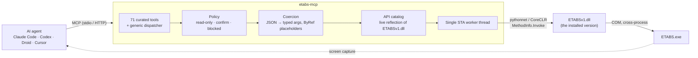

<!-- mcp-name: io.github.moha2005269/etabs-mcp -->
<div align="center">


<sub>Rendered from a live ETABS 23 session: every member, deflection and D/C ratio is real. <a href="https://github.com/Moha2005269/etabs-mcp/raw/main/docs/assets/hero.mp4">MP4</a></sub>

# etabs-mcp

### Your AI agent, inside ETABS.

An agentic **Model Context Protocol** server for **CSI ETABS v22+**. Claude Code, Codex, Factory Droid, Cursor and any
other MCP client can model, load, analyse, design and inspect structures the way an engineer does,
through the official ETABS API, with every call checked against the real signatures.

[](https://www.python.org/)
[](#version-support)
[](https://modelcontextprotocol.io)
[](#tested-against-real-etabs)
[](LICENSE)

[Quick start](#quick-start) · [Tools](#71-tools) · [How it works](#how-it-works) · [Testing](#tested-against-real-etabs) · [Configuration](#configuration)

</div>

---

## Why

ETABS has a huge automation API: **143 interfaces, 1,293 reachable methods, 58 enums**. It's also full of
`ref` arrays, status codes and silent quirks. Agents should be designing buildings, not wrestling with COM marshalling.

`etabs-mcp` gives agents two layers:

| | |
|---|---|
| **71 curated tools** | Engineer-shaped workflows: `etabs_generate_building`, `etabs_define_seismic_load`, `etabs_code_checks`, `etabs_run_analysis`, `etabs_get_results`, `etabs_run_design`, `etabs_render_view`, `etabs_find_objects`, `etabs_edit_table`, and more. |
| **The entire API** | `etabs_search_api` → `etabs_describe_api` → `etabs_call_api`. Every ETABS method is callable with plain JSON, validated against the live signature of the ETABS version you run. |

## Highlights

<table>
<tr>
<td width="33%" valign="top">

**Full coverage, zero guesswork**<br>
Search all 1,293 methods, read exact signatures with enum values, and call any of them. ByRef outputs come back as named JSON.

</td>
<td width="33%" valign="top">

**Sees like an engineer**<br>
`etabs_render_view` draws the model offscreen from any angle: deformed shapes, D/C ratios, sections, stories. `etabs_screenshot` shows the real ETABS window.

</td>
<td width="33%" valign="top">

**The Interactive Database**<br>
Read any of ETABS's tables and **edit importable ones** (update / append / delete rows, then apply), with the import log returned.

</td>
</tr>
<tr>
<td valign="top">

**Safe by design**<br>
Destructive calls need `confirm=true`, internals are blocked, and `--read-only` mode refuses every write. Tool annotations tell clients what is safe.

</td>
<td valign="top">

**Version-adaptive**<br>
Finds every ETABS 22/23/24… install, loads *that* version's `ETABSv1.dll` and reflects its API live. Methods missing in older versions fail clearly.

</td>
<td valign="top">

**Built for agents**<br>
Errors carry a code and a **hint**. Lengths accept `"6 m"` or `"20 ft"`, long runs go to background jobs, and `etabs_what_changed` notices hand edits in ETABS.

</td>
</tr>
</table>

---

## Quick start

**Requirements:** Windows · ETABS 22 or newer (licensed) · Python 3.10+ · the .NET 8 Desktop Runtime (installed with ETABS 22+).

Install from PyPI:

```bash
pip install etabs-mcp
```

Or run it without installing, using [uv](https://docs.astral.sh/uv/):

```bash
uvx etabs-mcp --list-installs
```

**Claude Desktop, one click:** download `etabs-mcp-<version>-py3XX.mcpb` for your Python version from the
[latest release](https://github.com/Moha2005269/etabs-mcp/releases/latest) and open it. Claude Desktop installs
the extension with every dependency bundled.

Check that it finds ETABS:

```bash
etabs-mcp --list-installs
```

### Connect your agent

<details open>
<summary><b>Claude Code</b></summary>

```bash
claude mcp add etabs -- etabs-mcp
```
Analyses can take minutes on big models; raise the tool timeout with `MCP_TOOL_TIMEOUT=600000`.
</details>

<details>
<summary><b>OpenAI Codex</b></summary>

`~/.codex/config.toml`
```toml
[mcp_servers.etabs]
command = "etabs-mcp"
tool_timeout_sec = 600
```
</details>

<details>
<summary><b>Factory Droid · Cursor · Claude Desktop · Windsurf · any MCP client</b></summary>

```json
{
  "mcpServers": {
    "etabs": {
      "command": "etabs-mcp",
      "env": { "ETABS_MCP_CONNECT_MODE": "auto" }
    }
  }
}
```
</details>

<details>
<summary><b>HTTP (remote agents, multiple clients)</b></summary>

```bash
etabs-mcp --transport streamable-http --port 8765
```
</details>

Then just ask:

> *"Model a 2-storey steel frame, 2×1 bays of 6 m × 5 m, W14X90 columns, W18X35 beams, 200 mm slab.
> Apply 1.5 kPa SDL and 3 kPa live, run the analysis, report T₁, wind drift and the worst steel D/C ratio,
> and show me the 3D view."*

The server connects on its own: it attaches to a running ETABS, or launches one.

---

## 71 tools

| Area | Tools |
|---|---|
| **Session** | `etabs_list_installations` · `etabs_connect` · `etabs_status` · `etabs_disconnect` |
| **Model & file** | `etabs_model_overview` · `etabs_new_model` · `etabs_open_model` · `etabs_save_model` · `etabs_set_units` · `etabs_get_stories` · `etabs_set_stories` |
| **Geometry** | `etabs_add_frames` · `etabs_add_areas` · `etabs_add_points` · `etabs_list_objects` · `etabs_delete_objects` · `etabs_set_restraints` · `etabs_assign_section` · `etabs_select` |
| **Properties** | `etabs_list_properties` · `etabs_define_material` · `etabs_define_frame_section` · `etabs_define_area_section` |
| **Loads** | `etabs_define_load_patterns` · `etabs_assign_loads` · `etabs_define_combinations` · `etabs_list_load_definitions` |
| **Lateral system** | `etabs_define_seismic_load` (ASCE 7-16 ELF) · `etabs_define_wind_load` (ASCE 7-16/7-22, other codes via fields) · `etabs_define_response_spectrum` · `etabs_set_mass_source` · `etabs_assign_diaphragm` · `etabs_set_modal_case` |
| **Generate** | `etabs_generate_building`: grids, stories, steel moment/braced or concrete frame/wall systems, slabs, supports, diaphragm and gravity loads in one call |
| **Analysis & design** | `etabs_run_analysis` · `etabs_analysis_status` · `etabs_unlock_model` · `etabs_get_results` · `etabs_run_design` · `etabs_get_design_summary` · `etabs_design_codes` |
| **Concrete & walls** | `etabs_get_concrete_design` (beams, columns, joints) · `etabs_run_shear_wall_design` · `etabs_get_wall_design` (piers, spandrels) · `etabs_get_slab_design` (strips, punching) |
| **Code checks** | `etabs_code_checks` (drift, torsional/soft-story/weight irregularity, modal mass, RS vs ELF) · `etabs_scale_response_spectrum` |
| **Background jobs** | `etabs_job_status` · `etabs_job_wait`: analysis and design with `background=true` never hit client timeouts |
| **Database tables** | `etabs_list_tables` · `etabs_get_table` · `etabs_edit_table` |
| **See & query** | `etabs_render_view` · `etabs_find_objects` · `etabs_screenshot` · `etabs_show_window` · `etabs_refresh_view` |
| **Track & undo** | `etabs_what_changed` · `etabs_checkpoint` · `etabs_list_checkpoints` · `etabs_restore_checkpoint` |
| **Export & report** | `etabs_export_model` (full `.e2k` text, paged) · `etabs_design_report` (Markdown) · `etabs_assign_label` (groups, piers, spandrels) |
| **Menus & dialogs** | `etabs_menu` (browse and run ETABS menu commands the API lacks) · `etabs_dialogs` |
| **Instances** | `etabs_instances`: drive several ETABS at once (`etabs_connect(instance=...)`), switch, remove |
| **Entire API** | `etabs_search_api` · `etabs_describe_api` · `etabs_call_api` · `etabs_call_api_batch` |

Plus **resources** (`etabs://api/interfaces`, `etabs://api/interface/{name}`, `etabs://api/enum/{name}`,
`etabs://server/info`) and a **prompt** (`etabs_build_and_check`) that walks an agent through the full workflow.

<details>
<summary><b>Example: anything the curated tools don't cover</b></summary>

```jsonc
// 1. find it
etabs_search_api({ "query": "frame releases" })
// → SapModel.FrameObj.SetReleases(Name, ref II[], ref JJ[], ref StartValue[], ref EndValue[], ItemType)

// 2. call it: plain JSON, validated and converted to the exact .NET types
etabs_call_api({
  "path": "FrameObj.SetReleases",
  "args": { "Name": "13", "II": [false,false,false,false,false,true],
            "JJ": [false,false,false,false,false,true],
            "StartValue": [0,0,0,0,0,0], "EndValue": [0,0,0,0,0,0] }
})
// → { "ok": true, "ret": 0, "outputs": { ... } }
```
</details>

---

## What the agent sees

The film above is cut from one recorded session. An agent built a 6-storey, 4×3-bay braced steel building
through `etabs-mcp`, analysed it, ran the AISC 360-16 check, found 48 overstressed girders, upsized them,
and re-ran everything until no member was over capacity.

<table>
<tr>
<td width="33%"></td>
<td width="33%"></td>
<td width="33%"></td>
</tr>
<tr>
<td align="center"><sub><b>Model</b> · 354 members, 72 slabs, 30 tool calls</sub></td>
<td align="center"><sub><b>Design</b> · 48 over capacity, max D/C 1.22</sub></td>
<td align="center"><sub><b>Iterate</b> · W24X76 × 48 → 0 over capacity, max D/C 0.91</sub></td>
</tr>
</table>

### `etabs_render_view`

The agent's own view of the model, drawn from its data. It works with ETABS hidden, never takes focus, and shows
what the ETABS API cannot switch the GUI to.

<table>
<tr>
<td width="33%"></td>
<td width="33%"></td>
<td width="33%"></td>
</tr>
<tr>
<td align="center"><sub><code>color_by="design_ratio"</code></sub></td>
<td align="center"><sub><code>deformed_case="EQX", color_by="displacement"</code></sub></td>
<td align="center"><sub><code>color_by="section", theme="light"</code></sub></td>
</tr>
</table>


<p align="center"><sub>The same model in ETABS itself, captured by the agent with <code>etabs_screenshot</code>.</sub></p>

---

## How it works



**Reverse-engineering the API, not ETABS.** This server stays on the official, documented OAPI and never patches
or decompiles the ETABS engine. Its API surface was mapped from the shipped interop assembly:

1. **REA** static metadata analysis of `ETABSv1.dll`: 365 types, 3,275 method defs, 14,752 parameters.
2. A **reflection dumper** (`tools/ApiDump`) emits every public interface, signature, ByRef flag, default and enum
   into [`etabs_api_spec.json`](src/etabs_mcp/data/etabs_api_spec.json).
3. **Cross-check:** reflection and raw metadata agree exactly (e.g. `cFrameObj` + `cAnalysisResults` +
   `cDatabaseTables` = 136 methods + 1 property accessor = REA's 137).
4. At runtime the server **re-reflects the loaded DLL**, so validation always matches the ETABS you run.

**Engineering details that make it "just work":**

- **Typed marshalling.** pythonnet boxes Python `int` as `PyInt` inside `object[]`, which reflection rejects for
  `Int32`. Every argument is routed through a one-element typed array and `Array.Copy`, so ETABS gets real
  `Int32`/`Double`/enum boxes and ByRef arrays.
- **One thread.** ETABS and COM proxies aren't thread-safe; every call is serialised on a single worker.
- **Lost connections** (ETABS closed or crashed) are detected from HRESULTs and reported with a reconnect hint.
- **ETABS quirks handled:**
  - Library imports that ETABS silently renames (`W14X90` → `W14X90-1`) are detected and renamed back.
  - After table edits, ETABS reports the model file as the temporary `.$et`; saving is mapped back to `.EDB`.
  - Unitless result columns (drift ratios, mass ratios) are turned into numbers, while IDs like `Label: "1"` stay strings.
  - GPU-drawn viewports are blank to `PrintWindow`, so screenshots come from the composed screen and focus is handed back afterwards.

---

## Tested against real ETABS

**Offline (CI):** 58 tests. Every curated tool runs through FastMCP against a fake backend that resolves and
coerces **every call against the real `ETABSv1.dll` catalog**. A wrong method or parameter name fails exactly as it
would in ETABS.

**Live end-to-end:** [`tests/live/test_live_e2e.py`](tests/live/test_live_e2e.py) starts the server as a real
MCP subprocess, launches ETABS 23.3.2, and runs **42 tool calls with 0 failures in ~42 s**:

| Step | Verified |
|---|---|
| Model | 2 storeys, 26 frames (library W-shapes), 4 slabs, 6 fixed supports |
| Loads | SDL / LL / wind patterns, area + line + joint loads, 2 combos + AISC defaults |
| Analysis | all cases finished in 9.8 s; model locks |
| Base reactions | **LL ΣFz = 360 kN = 3 kPa × 120 m², exact**; SDL matches slab + line-load hand calc |
| Modal / drift | T₁ = 0.398 s · max wind drift 1/1846 |
| Design | 26 steel members (AISC 360-16), max D/C 0.35, 0 failing |
| Generic API | releases set and read back, a 9-call batch, status-code failures, validation and confirm errors |
| Tables | read 26 section assignments, edit one through the Interactive Database, verify through the API |
| Lifecycle | unlock, save (`.EDB`), screenshot, clean ETABS shutdown |

**Live v0.2 suite:** [`tests/live/test_live_v2.py`](tests/live/test_live_v2.py) drives every new tool against
ETABS on a 3-storey, 63-member model:

| Step | Verified |
|---|---|
| Units | `"3.5 m"`, `"4200 mm"`, `"500 mm"` inputs land as the right values |
| Find & label | 27 columns, 12 beams on Story2, 18 beams ≥ 7.5 m (selected), group round-trip |
| Lateral | ASCE 7-16 seismic (X, X±E), auto wind, ASCE 7-16 spectrum + RS case, mass source, diaphragm on 12 slabs, 9 modes |
| Change tracking | a hand edit and an added beam are both reported; the checkpoint restores the model |
| Background jobs | analysis returns at once; other calls get `busy`; `job_wait` returns the result |
| Results | EQX, WX and RSX base shears; X-only seismic gives exactly zero FY |
| Seeing | design-ratio, deformed, section and plan renders; AISC 341 design errors flagged, never shown as safe |
| Export & report | `.e2k` sections, Markdown report with reactions, modes, drifts and design |

**Live v0.3 suite:** [`tests/live/test_live_v3.py`](tests/live/test_live_v3.py):

| Step | Verified |
|---|---|
| Generator | 4-storey concrete shear-wall building on a non-uniform grid (8/6/8 m); steel braced building in kip-ft |
| Hand check | steel building LL ΣFz = 0.05 ksf × 90 ft × 50 ft × 3 floors, exact |
| Code checks | drift (Cd-amplified), torsion, soft story, weight, modal mass (12 modes), RS vs ELF |
| RS scaling | response spectrum scaled to 100% of ELF, re-analysed, ratio 1.00 verified |
| Concrete & walls | ACI 318-19 beams, all 48 columns, joints; shear walls designed through the menu, pier results read back |

**Showcase run** ([`tools/record_demo_data.py`](tools/record_demo_data.py)): a 6-storey braced steel building,
354 members and 72 slabs. LL ΣFz = 9,720 kN (= 3 kPa × 30 m × 18 m × 6 floors, exact), wind ΣFx = 432 kN
(= 18 kN × 24 joints, exact), T₁ = 1.71 s. The redesign loop took max D/C from 1.22 to 0.91.

```bash
pip install -e ".[dev]"
pytest                                   # offline suite
ETABS_MCP_ARTIFACTS=docs/live pytest tests/live --live -s   # drives your local ETABS
```

---

## Configuration

| Env var / flag | Default | Meaning |
|---|---|---|
| `ETABS_MCP_CONNECT_MODE` / `--connect-mode` | `auto` | `attach` to a running ETABS, `start` a new one, or `auto` (attach if one is open, else start) |
| `ETABS_MCP_VERSION` / `--etabs-version` | newest | ETABS major version to use, e.g. `22` |
| `ETABS_MCP_INSTALL_DIR` / `--install-dir` | auto | ETABS program folder |
| `ETABS_MCP_VISIBLE` / `--hidden` | visible | Show the ETABS window when launching |
| `ETABS_MCP_READ_ONLY` / `--read-only` | off | Refuse every call that changes the model |
| `ETABS_MCP_ALLOW_DESTRUCTIVE` / `--allow-destructive` | off | Skip `confirm=true` for destructive calls (CI / unattended use) |
| `ETABS_MCP_RUNTIME` | `coreclr` | .NET host for pythonnet (`netfx` as a fallback) |
| `ETABS_MCP_MAX_ARRAY_ITEMS` | 2000 | Cap on array lengths returned by `etabs_call_api` |
| `ETABS_MCP_MAX_TABLE_ROWS` | 500 | Default page size for tables and results |
| `ETABS_MCP_AUDIT_LOG` / `--audit-log` | off | Append every model-changing call (time, instance, call, arguments, result) to a JSON-lines file |
| `ETABS_MCP_TOKEN` / `--token` | none | Bearer token for `--transport streamable-http/sse`; required to listen beyond localhost |

### Publishing (maintainers)

Tagging `vX.Y.Z` runs [`release.yml`](.github/workflows/release.yml), which tests, builds the wheel, sdist and
`.mcpb` bundles, and publishes the GitHub release. PyPI and the MCP Registry use tokenless trusted publishing:
add a trusted publisher on pypi.org (this repo, workflow `release.yml`, environment `pypi`), then set the
repository variable `PUBLISH_PYPI=true`. Later tags publish to PyPI and list the server in the MCP Registry.

### Version support

| ETABS | Status |
|---|---|
| 23.x | ✅ Verified live (23.3.2) |
| 22.x | ✅ Supported: same .NET 8 API; the catalog is reflected from your installed DLL |
| 24+ | ✅ Expected to work: new methods appear automatically through live reflection |
| ≤ 21 | ❌ Not supported (.NET Framework era API) |

### Safety model

| Level | Examples | Behaviour |
|---|---|---|
| read | `Get*`, `Count*`, tables, results | always allowed |
| write | `Set*`, `Add*`, analysis, design | blocked in read-only mode |
| destructive | `Delete*`, new/open model, unlock (deletes results), close ETABS | needs `confirm=true` |
| blocked | `InternalExec`, plugin hooks, active-object switching | never callable |

Menu commands run through `etabs_menu` need `confirm=true` as well, and over HTTP every request must carry the
bearer token.

---

## Project layout

```
src/etabs_mcp/
  server.py        FastMCP assembly: tools, resources, prompt, agent instructions
  session.py       connection lifecycle + single worker thread + generic call()
  dotnet.py        pythonnet host, live reflection, typed marshalling, connection-loss detection
  catalog.py       API catalog: path resolution, search, describe
  coerce.py        JSON → signature-typed values, results → JSON
  policy.py        read / write / destructive / blocked classification
  discovery.py     ETABS installs and running instances
  screenshot.py    window capture
  render.py        offscreen model renderer (etabs_render_view)
  units.py         unit-aware lengths ("6 m", "20 ft", "250 mm")
  gui.py           ETABS menu commands through Windows UI Automation
  http.py          HTTP transports with bearer-token auth
  tools/           curated tools (connection, model, generator, geometry, properties, loads, lateral,
                   analysis, concrete, checks, tables, view, insight, api)
mcpb/              Claude Desktop extension manifest    server.json   MCP Registry entry
  data/etabs_api_spec.json   reflected API of ETABSv1.dll
tools/ApiDump                .NET reflection dumper that produced the API spec
tools/record_demo_data.py    drives the MCP tools against live ETABS and records the showcase data
tools/render_hero.py         renders the README film and stills from that data
tools/build_mcpb.py          builds the Claude Desktop extensions
tests/             offline suite + live end-to-end test
```

## Troubleshooting

- **`install_not_found`**: run `etabs-mcp --list-installs`; set `ETABS_MCP_INSTALL_DIR` if ETABS lives somewhere unusual.
- **Attaching does nothing**: wait until ETABS has finished starting and close any modal dialogs; or pass `pid` to `etabs_connect`.
- **Edits fail after analysis**: the model is locked. `etabs_unlock_model(confirm=true)` deletes results and unlocks it.
- **Long analyses time out in the client**: raise the client's MCP tool timeout (see [Connect your agent](#connect-your-agent)).
- **Switching ETABS major versions**: restart the server; one process hosts one `ETABSv1.dll`.

---

<div align="center">

Apache-2.0 © Moha2005269 · ETABS is a trademark of Computers and Structures, Inc. This project is independent and not affiliated with or endorsed by CSI.

</div>
